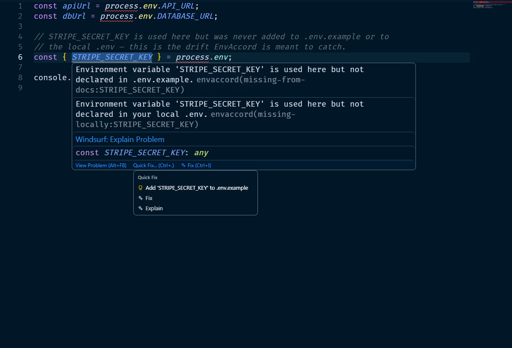
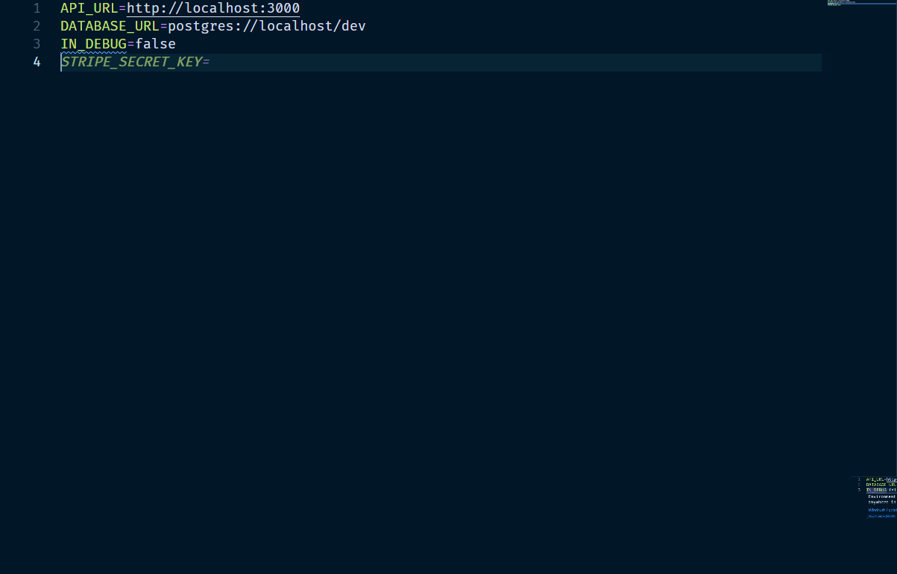
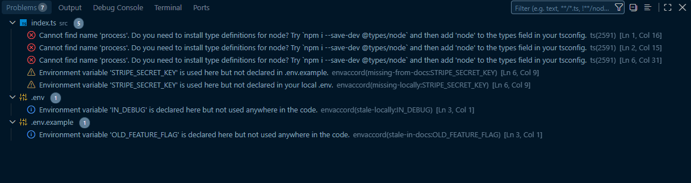
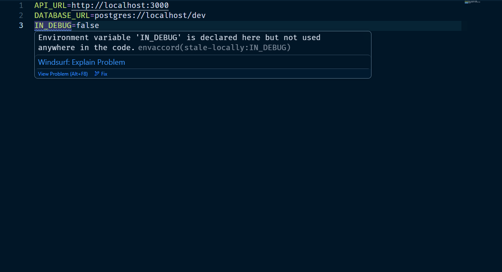

# EnvAccord

Catches environment variable drift before it breaks your "works on my
machine" moment. EnvAccord statically analyzes which variables your code
actually reads, then checks that against your `.env.example` and your
local `.env` — flagging what's missing and what's no longer used. No AI,
no schema migration, no new file format: it works with the `.env` files
your project already has.

## See it in action

A missing variable is underlined the moment you use it — hover for
details, click the lightbulb to fix it in one step:



Autocomplete without AI — open your `.env` file and EnvAccord suggests the
variables your code already uses. Press Tab to accept, Copilot-style:



Every category of drift also shows up in the Problems panel, so nothing
gets missed even in files you're not currently looking at:



It catches the opposite problem too — a variable sitting in your `.env`
that nothing in the code uses anymore:



## Status

v1 — core engine, CLI and VS Code extension all working. Not yet published.

## What it detects

1. **Missing from docs** — a variable read in code that isn't declared in
   `.env.example` / `.env.sample` / `.env.template`.
2. **Missing locally** — a variable read in code that isn't declared in
   your own local `.env`.
3. **Stale in docs** — a variable declared in the docs file that no code
   reads anymore.
4. **Stale locally** — a variable declared in your local `.env` that no
   code reads anymore.

Detection is AST-based (TypeScript Compiler API), so it understands direct
access (`process.env.NAME`), bracket access (`process.env['NAME']`), and
destructuring (`const { NAME } = process.env`) — including renamed and
rest-spread destructuring — across `.js`, `.jsx`, `.ts` and `.tsx`.
`import.meta.env.NAME` (Vite) is also recognized.

## VS Code extension

- **Diagnostics** — missing/stale variables are underlined directly in the
  editor and listed in the Problems panel, updated live as you edit and
  save.
- **Quick fix** — click the lightbulb on a "missing from docs" warning to
  add the variable to your docs file automatically.
- **Inline completion** — open any `.env`/`.env.example`/`.env.sample`/
  `.env.template` file and get ghost-text suggestions (accept with Tab,
  Copilot-style) for variables your code uses but that file doesn't
  declare yet.

## CLI

```bash
npm install
npm run compile
node ./out/cli.js <path-to-project>   # or omit the path to scan the current directory
node ./out/cli.js <path-to-project> --json
```

## Tests

```bash
npm test
```

## Example

See `examples/demo-project` for a small project with deliberate drift,
covering all four categories above.
